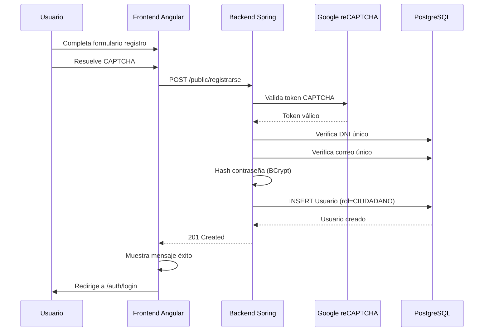
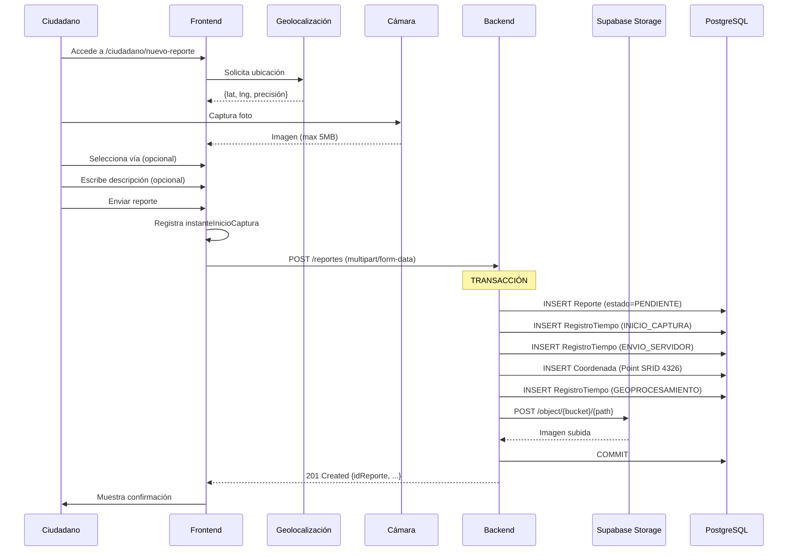
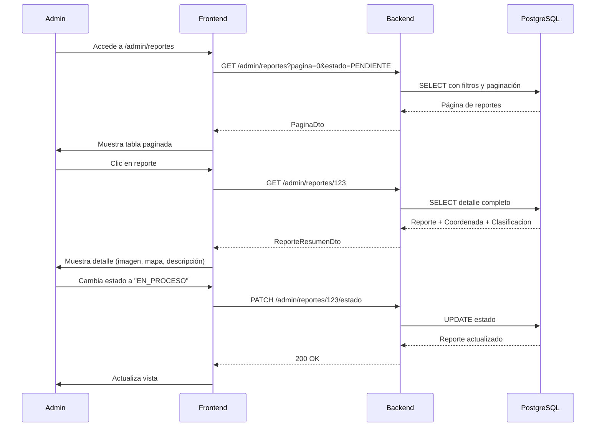

# Reporte de Análisis: Sistema Visor Vial (Synthevia)

## Resumen Ejecutivo

**Visor Vial (Synthevia)** es una aplicación web full-stack para la gestión de reportes de problemas viales georeferenciados. Los ciudadanos pueden reportar problemas en las vías mediante fotografías geolocalizadas, y los administradores pueden gestionar estos reportes a través de un panel de control.

**Arquitectura:** Backend Java con Spring Boot 4 + Frontend Angular 22  
**Estado:** Prototipo funcional en desarrollo  
**Versión:** 0.0.1-SNAPSHOT

---

## 1. Arquitectura del Sistema

### 1.1 Stack Tecnológico

#### Backend
- **Framework:** Spring Boot 4.0.8
- **Lenguaje:** Java 24
- **Build Tool:** Gradle
- **Base de Datos:** PostgreSQL con extensión PostGIS (vía Supabase)
- **ORM:** Spring Data JPA con Hibernate Spatial
- **Seguridad:** Spring Security con BCrypt
- **Arquitectura:** RESTful API con patrón MVC en capas

#### Frontend
- **Framework:** Angular 22.1.0 (standalone components)
- **Lenguaje:** TypeScript 6.0.2
- **UI Framework:** Bootstrap 5.3.8 + Bootstrap Icons + FontAwesome
- **Estado:** Signals de Angular + SessionStorage
- **Build Tool:** Angular CLI + Vite

#### Servicios Externos
- **Supabase:** Base de datos PostgreSQL + Storage para imágenes
- **Google reCAPTCHA v2:** Protección anti-bots
- **PostGIS:** Extensión geoespacial para coordenadas GPS

### 1.2 Estructura de Directorios

```
visor_vial/
├── backend/
│   ├── src/main/java/com/infraestrctura/synthevia/
│   │   ├── config/          # Configuración (CORS, Security)
│   │   ├── controlador/     # Controllers REST
│   │   ├── dto/             # Data Transfer Objects
│   │   ├── entidad/         # Entidades JPA
│   │   ├── repositorio/     # Repositories Spring Data
│   │   └── servicio/        # Lógica de negocio
│   ├── build.gradle         # Dependencias y configuración
│   └── .env                 # Variables de entorno
│
└── frontend/
    ├── src/app/
    │   ├── core/            # Guards, Services, Models
    │   ├── features/        # Módulos funcionales
    │   │   ├── admin/       # Panel administrativo
    │   │   ├── auth/        # Autenticación
    │   │   └── ciudadano/   # Interfaz ciudadano
    │   └── shared/          # Componentes compartidos
    └── package.json         # Dependencias npm
```

---

## 2. Modelo de Datos

### 2.1 Entidades Principales

#### Usuario
```java
@Entity
@Table(name = "usuario")
public class Usuario {
    @Id Integer idUsuario;
    String dni;                    // 8 dígitos, único
    String nombre;
    String apellidos;
    String correoElectronico;      // único
    String contrasenaHash;         // BCrypt
    String rol;                    // "CIUDADANO" | "ADMIN"
    Short reportesHoy;             // Límite diario
    LocalDate fechaUltimoReporte;
    OffsetDateTime fechaCreacion;
}
```

**Reglas de negocio:**
- DNI debe ser único (8 dígitos)
- Correo electrónico único (case-insensitive)
- Contraseña hasheada con BCrypt
- Rol por defecto: "CIUDADANO"
- Control de reportes diarios mediante `reportesHoy`

#### Reporte
```java
@Entity
@Table(name = "reporte")
public class Reporte {
    @Id Integer idReporte;
    Integer idUsuario;             // FK a Usuario
    Integer idVia;                 // FK a ViaSegmento (opcional)
    String imagenUrl;              // Ruta en Supabase Storage
    String descripcion;            // Texto libre (opcional)
    String estado;                 // PENDIENTE|EN_PROCESO|RESUELTO|DUPLICADO
    Integer reporteOriginalId;     // FK a otro Reporte (si es duplicado)
    OffsetDateTime fechaCreacion;
}
```

**Estados del ciclo de vida:**
1. **PENDIENTE** (inicial): Requiere revisión
2. **EN_PROCESO**: Administrador trabajando en solución
3. **RESUELTO**: Problema solucionado
4. **DUPLICADO**: Reporte repetido (referencia al original)

#### Coordenada
```java
@Entity
@Table(name = "coordenada")
public class Coordenada {
    @Id Integer idCoordenada;
    Integer idReporte;                      // FK único (1-a-1)
    Point puntoCapturado;                   // geometry(Point, 4326)
    BigDecimal precisionReportadaMetros;    // Precisión GPS
    OffsetDateTime fechaCaptura;
}
```

**Detalles técnicos:**
- Sistema de coordenadas: WGS84 (SRID 4326) - estándar GPS
- Tipo PostGIS: `geometry(Point, 4326)`
- Precisión reportada desde dispositivo móvil
- Relación 1-a-1 con Reporte

#### Clasificacion
```java
@Entity
@Table(name = "clasificacion")
public class Clasificacion {
    @Id Integer idClasificacion;
    Integer idReporte;              // FK único (1-a-1)
    Short severidad;                // 1, 2, 3
    String etiquetaDetectada;       // Ej: "bache", "grieta"
    BigDecimal nivelConfianza;      // 0.0 - 1.0
    String modeloIaUtilizado;       // Nombre del modelo
    String versionModelo;
    OffsetDateTime fechaProcesamiento;
}
```

**Estado:** Preparado para integración con IA, actualmente no implementado.

#### ViaSegmento
```java
@Entity
@Table(name = "via_segmento")
public class ViaSegmento {
    @Id Integer idVia;
    String codigoSegmento;    // Código de vía
    String nombreVia;         // Nombre descriptivo
    OffsetDateTime fechaRegistro;
}
```

**Propósito:** Catálogo de vías/calles donde ocurren reportes.

#### RegistroTiempo
```java
@Entity
@Table(name = "registro_tiempo")
public class RegistroTiempo {
    @Id Integer idRegistro;
    Integer idReporte;              // FK
    String etapa;                   // INICIO_CAPTURA|ENVIO_SERVIDOR|GEOPROCESAMIENTO
    OffsetDateTime timestamp;
    String origenEvento;           // "CLIENTE" | "SERVIDOR"
}
```

**Propósito:** Auditoría de tiempos del flujo de creación de reportes.

### 2.2 Diagrama de Relaciones

```
Usuario (1) ──────< (N) Reporte
                        │
                        ├──── (1) Coordenada
                        ├──── (1) Clasificacion
                        ├──── (N) RegistroTiempo
                        └──── (1) ViaSegmento (opcional)
                        
Reporte.reporteOriginalId ──> Reporte.idReporte (auto-referencia)
```

---

## 3. API REST - Endpoints

### 3.1 Endpoints Públicos

#### POST `/public/iniciar-sesion`
**Descripción:** Autenticación de usuarios  
**Request:**
```json
{
  "dni": "12345678",
  "contrasena": "miPassword123",
  "captchaToken": "03AGdBq2..."
}
```
**Response (200 OK):**
```json
{
  "exito": true,
  "mensaje": "Inicio de sesión exitoso",
  "nombre": "Juan Pérez",
  "rol": "CIUDADANO"
}
```

#### POST `/public/registrarse`
**Descripción:** Registro de nuevos ciudadanos  
**Request:**
```json
{
  "dni": "87654321",
  "nombre": "María",
  "apellidos": "García López",
  "correoElectronico": "maria@email.com",
  "contrasena": "Password123",
  "captchaToken": "03AGdBq2..."
}
```
**Response (201 Created):**
```json
{
  "exito": true,
  "mensaje": "Cuenta creada correctamente."
}
```

### 3.2 Endpoints de Ciudadano

#### POST `/reportes`
**Descripción:** Crear nuevo reporte con imagen  
**Content-Type:** `multipart/form-data`  
**Request:**
- **reporte** (JSON):
  ```json
  {
    "idVia": 5,
    "descripcion": "Bache grande en carril derecho",
    "latitud": -12.046374,
    "longitud": -77.042793,
    "precisionReportadaMetros": 15.5,
    "instanteInicioCaptura": "2026-09-29T10:30:00Z"
  }
  ```
- **imagen** (file): Archivo JPEG/PNG/WebP (max 5MB)

**Response (201 Created):**
```json
{
  "idReporte": 123,
  "idUsuario": 45,
  "idVia": 5,
  "imagenUrl": "reportes/2026/09/uuid-123.jpg",
  "descripcion": "Bache grande...",
  "estado": "PENDIENTE",
  "fechaCreacion": "2026-09-29T10:30:15Z"
}
```

### 3.3 Endpoints de Administrador

#### GET `/admin/reportes`
**Descripción:** Listar reportes con paginación y filtros  
**Query params:**
- `pagina` (int, default: 0)
- `tamanio` (int, default: 10)
- `estado` (string, opcional): PENDIENTE|EN_PROCESO|RESUELTO|DUPLICADO
- `busqueda` (string, opcional): búsqueda en descripción

**Response (200 OK):**
```json
{
  "contenido": [
    {
      "idReporte": 123,
      "idUsuario": 45,
      "idVia": 5,
      "imagenUrl": "reportes/2026/09/uuid-123.jpg",
      "descripcion": "Bache grande...",
      "estado": "PENDIENTE",
      "fechaCreacion": "2026-09-29T10:30:15Z"
    }
  ],
  "numeroPagina": 0,
  "totalPaginas": 5,
  "totalElementos": 48
}
```

#### GET `/admin/reportes/{id}`
**Descripción:** Obtener detalle de un reporte  
**Response (200 OK):** ReporteResumenDto individual

#### PATCH `/admin/reportes/{id}/estado`
**Descripción:** Actualizar estado de un reporte  
**Request:**
```json
{
  "estado": "EN_PROCESO"
}
```
**Response (200 OK):** ReporteResumenDto actualizado

#### DELETE `/admin/reportes/{id}`
**Descripción:** Eliminar un reporte  
**Response (204 No Content):** Sin contenido

#### GET `/admin/reportes/estadisticas`
**Descripción:** Obtener estadísticas del dashboard  
**Response (200 OK):**
```json
{
  "total": 150,
  "pendientes": 45,
  "enProceso": 30,
  "resueltos": 70,
  "duplicados": 5
}
```

#### GET `/admin/vias`
**Descripción:** Listar vías disponibles  
**Response (200 OK):** Array de ViaSegmento

---

## 4. Funcionalidades Implementadas

### 4.1 Para Ciudadanos (Rol: CIUDADANO)

#### ✅ Registro de Cuenta
- Formulario con validación de DNI (8 dígitos único)
- Validación de correo electrónico único
- Contraseña hasheada con BCrypt
- Protección reCAPTCHA contra bots
- Rol "CIUDADANO" asignado automáticamente

#### ✅ Inicio de Sesión
- Autenticación con DNI + contraseña
- Verificación reCAPTCHA
- Sesión almacenada en sessionStorage
- Redirección automática según rol

#### ✅ Creación de Reportes
- Captura de fotografía desde dispositivo
- Geolocalización automática (GPS)
- Selección opcional de vía
- Descripción opcional (max 1000 caracteres)
- Subida a Supabase Storage
- Registro de timestamps (captura, envío, procesamiento)
- Límite diario de reportes por usuario

### 4.2 Para Administradores (Rol: ADMIN)

#### ✅ Dashboard Estadístico
- Total de reportes
- Contadores por estado (Pendientes, En Proceso, Resueltos, Duplicados)
- Visualización en cards

#### ✅ Gestión de Reportes
- Tabla paginada (10 reportes por página)
- Filtrado por estado
- Búsqueda por texto en descripción
- Ver detalle completo de reporte
- Actualizar estado (workflow: PENDIENTE → EN_PROCESO → RESUELTO)
- Marcar como DUPLICADO con referencia al original
- Eliminar reportes

#### ✅ Gestión de Vías
- Listar vías/segmentos disponibles
- Asociar reportes a vías específicas

### 4.3 Sistema de Seguridad

#### ✅ Autenticación
- Credenciales basadas en DNI + contraseña
- Hash BCrypt para contraseñas
- Sin tokens JWT (sesión stateless con validación en cada request)

#### ✅ Autorización
- Guards de Angular: `authGuard` + `rolGuard`
- Control de acceso basado en roles
- Redirección automática según permisos

#### ✅ Protección Anti-Bots
- Google reCAPTCHA v2 en login y registro
- Validación server-side de tokens

#### ✅ CORS
- Configurado para localhost:4200 (Angular dev)
- Configurado para localhost:5173 (Vite)

---

## 5. Flujos de Trabajo Detallados

### 5.1 Flujo: Registro de Usuario



### 5.2 Flujo: Creación de Reporte



**Manejo de errores:**
- Si falla después de subir imagen a Storage: eliminación compensatoria
- Rollback de transacción en caso de error en BD

### 5.3 Flujo: Gestión de Reporte por Admin



---

## 6. Configuración y Despliegue

### 6.1 Variables de Entorno (Backend)

**Archivo:** `backend/.env`

```properties
# Base de datos PostgreSQL en Supabase
DB_URL=jdbc:postgresql://aws-0-us-east-1.pooler.supabase.com:5432/postgres
DB_USERNAME=postgres.lqwvnkhtcfiswmnikslr
DB_PASSWORD=visor_vial@@

# Supabase Storage
SUPABASE_URL=https://lqwvnkhtcfiswmnikslr.supabase.co
SUPABASE_STORAGE_BUCKET=reportes-viales
SUPABASE_SECRET_KEY=sb_secret_SvcvvGMklXGh-DkWSgl7CA_M64_V9TW

# Google reCAPTCHA
RECAPTCHA_SECRET_KEY=6LfoWeIrAAAAAD2tJutMn5jZEPCkKpLLroJHK113
```

### 6.2 Dependencias Clave

#### Backend (build.gradle)
```gradle
dependencies {
    // Soporte geoespacial
    implementation 'org.hibernate.orm:hibernate-spatial'
    runtimeOnly 'org.postgresql:postgresql'
    
    // Spring Boot starters
    implementation 'org.springframework.boot:spring-boot-starter-restclient'
    implementation 'org.springframework.boot:spring-boot-starter-data-jpa'
    implementation 'org.springframework.boot:spring-boot-starter-security'
    implementation 'org.springframework.boot:spring-boot-starter-validation'
    implementation 'org.springframework.boot:spring-boot-starter-webmvc'
}
```

#### Frontend (package.json)
```json
{
  "dependencies": {
    "@angular/common": "^22.1.0",
    "@angular/core": "^22.1.0",
    "@angular/forms": "^22.1.0",
    "@angular/router": "^22.1.0",
    "@fortawesome/fontawesome-free": "6.7.2",
    "bootstrap": "^5.3.8",
    "bootstrap-icons": "^1.13.1",
    "ng-recaptcha-2": "^22.0.1",
    "rxjs": "~7.8.0"
  }
}
```

### 6.3 Comandos de Ejecución

#### Backend
```bash
cd backend
./gradlew bootRun
# Servidor: http://localhost:8080
```

#### Frontend
```bash
cd frontend
npm install
npm start
# Aplicación: http://localhost:4200
```

---

## 7. Características Técnicas Destacadas

### 7.1 Geolocalización con PostGIS

- **Sistema de coordenadas:** WGS84 (SRID 4326) - estándar GPS mundial
- **Tipo de dato:** `geometry(Point, 4326)`
- **Biblioteca:** Hibernate Spatial + JTS (Java Topology Suite)
- **Precisión:** Almacenada en metros desde dispositivo GPS

```java
@Column(name = "punto_capturado", 
        nullable = false, 
        columnDefinition = "geometry(Point,4326)")
private Point puntoCapturado;
```

### 7.2 Gestión de Imágenes con Supabase Storage

**Estrategia de almacenamiento:**
```
reportes-viales/
└── reportes/
    └── {YYYY}/
        └── {MM}/
            └── {UUID}.{ext}

Ejemplo: reportes/2026/09/a1b2c3d4-e5f6-7890-abcd-ef1234567890.jpg
```

**Validaciones:**
- Tamaño máximo: 5 MB
- Formatos permitidos: JPEG, PNG, WebP
- Validación server-side

### 7.3 Auditoría de Tiempos

El sistema registra tres etapas temporales:

1. **INICIO_CAPTURA** (origen: cliente)
   - Timestamp cuando el usuario captura la foto
   - Usado para calcular latencia de red

2. **ENVIO_SERVIDOR** (origen: servidor)
   - Timestamp cuando el backend recibe la petición
   - Usado para análisis de carga

3. **GEOPROCESAMIENTO** (origen: servidor)
   - Timestamp después de guardar coordenadas
   - Usado para optimización de queries espaciales

### 7.4 Control de Límite de Reportes

**Implementación:**
```java
@Column(name = "reportes_hoy")
private Short reportesHoy;

@Column(name = "fecha_ultimo_reporte")
private LocalDate fechaUltimoReporte;
```

**Lógica:**
- Al crear reporte, verifica `fechaUltimoReporte`
- Si es hoy: incrementa `reportesHoy`
- Si es día anterior: resetea `reportesHoy = 1`
- Límite configurable por política (ej: 10 reportes/día)

---

## 8. Limitaciones y Áreas de Mejora

### 8.1 Seguridad

#### ⚠️ Crítico
- **Autenticación débil:** No usa JWT ni tokens, solo sesión en frontend
- **Endpoints abiertos:** `SecurityConfig` tiene `permitAll()` en todos los endpoints admin
- **Credenciales expuestas:** `.env` con secrets en repositorio (debería usar variables de entorno)
- **CSRF deshabilitado:** Vulnerable a Cross-Site Request Forgery

#### Recomendaciones
- Implementar JWT con refresh tokens
- Habilitar autorización basada en roles en `SecurityConfig`
- Mover secrets a variables de entorno del servidor
- Habilitar CSRF para operaciones POST/PUT/DELETE

### 8.2 Funcionalidades Pendientes

- ❌ **Clasificación IA:** Entidad preparada pero sin implementar
- ❌ **Gestión de usuarios (admin):** Rutas definidas pero sin implementar
- ❌ **Notificaciones push:** Para cambios de estado de reportes
- ❌ **Exportación de reportes:** PDF, Excel, CSV
- ❌ **Visualización en mapa:** Mapa con clusters de reportes
- ❌ **Sistema de comentarios:** Comunicación admin-ciudadano
- ❌ **Historial de cambios:** Auditoría de modificaciones de reportes

### 8.3 Optimizaciones

#### Performance
- **Índices espaciales:** Agregar índices GIST para columnas geometry
- **Paginación:** Considerar cursor-based pagination para grandes volúmenes
- **Caché:** Implementar Redis para estadísticas frecuentes

#### UX
- **Vista previa imagen:** Antes de subir reporte
- **Modo offline:** PWA para capturar reportes sin conexión
- **Edición de reportes:** Permitir editar descripción antes de revisión admin

### 8.4 Testing

- ❌ **Tests unitarios:** Mínimos o inexistentes
- ❌ **Tests de integración:** No implementados
- ❌ **Tests E2E:** No implementados

---

## 9. Casos de Uso Principales

### CU-01: Ciudadano reporta bache

**Actor principal:** Ciudadano registrado  
**Precondiciones:** Usuario autenticado, GPS activado, permisos de cámara  
**Flujo principal:**
1. Usuario navega a "Nuevo Reporte"
2. Sistema captura ubicación GPS
3. Usuario toma fotografía del bache
4. Usuario selecciona vía "Av. Arequipa" (opcional)
5. Usuario escribe "Bache profundo frente al banco"
6. Usuario envía reporte
7. Sistema valida imagen (< 5MB, formato válido)
8. Sistema sube imagen a Supabase
9. Sistema guarda reporte con estado PENDIENTE
10. Sistema muestra confirmación "Reporte enviado correctamente"

**Postcondiciones:** Reporte visible en panel admin, contador `reportesHoy` incrementado

### CU-02: Administrador gestiona reportes

**Actor principal:** Administrador  
**Precondiciones:** Usuario autenticado con rol ADMIN  
**Flujo principal:**
1. Admin navega a "Reportes"
2. Sistema muestra tabla con reportes PENDIENTES
3. Admin filtra por estado "PENDIENTE"
4. Admin busca "bache" en buscador
5. Sistema muestra reportes filtrados
6. Admin hace clic en reporte #123
7. Sistema muestra detalle: imagen, mapa, descripción
8. Admin cambia estado a "EN_PROCESO"
9. Sistema actualiza estado en BD
10. Admin agrega comentario (futuro) sobre reparación
11. Días después, admin marca como "RESUELTO"

**Postcondiciones:** Reporte con estado RESUELTO, estadísticas actualizadas

---

## 10. Conclusiones

### Fortalezas
✅ Arquitectura moderna y escalable (Spring Boot 4 + Angular 22)  
✅ Soporte geoespacial completo con PostGIS  
✅ Integración sólida con Supabase (BD + Storage)  
✅ Protección anti-bots con reCAPTCHA  
✅ Diseño responsive con Bootstrap  
✅ Auditoría de tiempos de procesamiento  
✅ Manejo transaccional robusto en creación de reportes  

### Debilidades
⚠️ Seguridad débil (sin JWT, endpoints abiertos)  
⚠️ Clasificación IA no implementada  
⚠️ Sin tests automatizados  
⚠️ Gestión de usuarios incompleta  
⚠️ Credenciales hardcoded en `.env`  

### Recomendaciones Prioritarias

1. **Seguridad (CRÍTICO):**
   - Implementar JWT con roles
   - Habilitar autorización en `SecurityConfig`
   - Mover secrets a variables de entorno

2. **Funcionalidades core:**
   - Implementar visualización en mapa (Leaflet/Google Maps)
   - Sistema de notificaciones a ciudadanos
   - Exportación de reportes a Excel/PDF

3. **Calidad:**
   - Agregar suite de tests (JUnit + Vitest)
   - Implementar CI/CD con GitHub Actions
   - Documentación de API con Swagger/OpenAPI

4. **Performance:**
   - Índices espaciales en PostgreSQL
   - Compresión de imágenes antes de subir
   - Caché de estadísticas

---

## Apéndice A: Tecnologías y Versiones

| Categoría | Tecnología | Versión |
|-----------|------------|---------|
| **Backend** | Spring Boot | 4.0.8 |
| | Java | 24 |
| | Gradle | 8.x |
| | Hibernate Spatial | (incluido en Spring Boot) |
| | PostgreSQL Driver | (incluido) |
| **Frontend** | Angular | 22.1.0 |
| | TypeScript | 6.0.2 |
| | Bootstrap | 5.3.8 |
| | RxJS | 7.8.0 |
| **Infraestructura** | PostgreSQL | (Supabase) |
| | PostGIS | (Supabase) |
| | Supabase Storage | API v1 |
| | Google reCAPTCHA | v2 |

---

## Apéndice B: Convenciones de Código

### Backend Java
- **Package naming:** `com.infraestrctura.synthevia.*` (typo: debería ser "infraestructura")
- **Nombrado entidades:** PascalCase (Usuario, Reporte)
- **Nombrado servicios:** `*Service.java`
- **Nombrado repositorios:** `*Repository.java`
- **Nombrado controladores:** `*Controller.java`
- **DTOs:** Sufijo `Dto` (CrearReporteDto)

### Frontend Angular
- **Componentes:** kebab-case (nuevo-reporte.component.ts)
- **Servicios:** camelCase (sessionService, reportesService)
- **Guards:** camelCase con sufijo Guard (authGuard, rolGuard)
- **Models:** PascalCase (Reporte, Usuario)
- **Rutas:** kebab-case (/admin/dashboard, /ciudadano/nuevo-reporte)

---

**Documento generado:** 29 de septiembre de 2026  
**Versión de la aplicación:** 0.0.1-SNAPSHOT  
**Autor del reporte:** Kiro AI Assistant  
